  

  

    
    
    
  

---

### About

I work close to the metal: exploring how systems behave, how they fail, and how to build tools that make those details easier to understand.

- 🎓 CyberSpace Security graduate from **Dalian University of Technology (DLUT)**.
- 🔬 Interested in **binary exploitation, kernel security, fuzzing, program analysis, and vulnerability research**.
- 🧩 Formerly with [SSS — Screw Cyber Security Studio](https://github.com/dlut-sss).
- 🏴 Former captain of [Scr1w](https://ctftime.org/team/176565).
- ✍️ Notes and write-ups: [loora1n.github.io](https://loora1n.github.io/).

### Focus Areas

  
  
  
  
  
  

### Selected Projects

<table>
  <tr>
    <td width="50%" valign="top">
      <h3><a href="https://github.com/Loora1N/pwnbase">pwnbase</a></h3>
      
Reusable user-space and kernel Pwn challenge bases.

    </td>
    <td width="50%" valign="top">
      <h3><a href="https://github.com/Loora1N/ProtoFuzz">ProtoFuzz</a></h3>
      
An AFL++-based fuzzer for TCP/UDP message-oriented protocols.

    </td>
  </tr>
  <tr>
    <td width="50%" valign="top">
      <h3><a href="https://github.com/Loora1N/how2ASAN">how2ASAN</a></h3>
      
Notes and experiments for understanding AddressSanitizer and memory-error detection.

    </td>
    <td width="50%" valign="top">
      <h3><a href="https://github.com/Loora1N/GM-crypto-assessment-wiki">GM Crypto Assessment Wiki</a></h3>
      
A knowledge base covering cryptographic standards, algorithms, protocols, products, and assessment.

    </td>
  </tr>
  <tr>
    <td width="50%" valign="top">
      <h3><a href="https://github.com/Loora1N/SealVerify">SealVerify</a></h3>
      
<strong>Work in progress.</strong> A planned tool for parsing and verifying OFD electronic seals and signatures.

    </td>
    <td width="50%" valign="top">
      <h3><a href="https://github.com/Loora1N">More repositories</a></h3>
      
More experiments, research notes, and tools are available on my GitHub profile.

    </td>
  </tr>
</table>

### GitHub Activity

  <picture>
    <source media="(prefers-color-scheme: dark)" srcset="https://raw.githubusercontent.com/Loora1N/Loora1N/output/github-contribution-grid-snake-dark.svg" />
    <source media="(prefers-color-scheme: light)" srcset="https://raw.githubusercontent.com/Loora1N/Loora1N/output/github-contribution-grid-snake.svg" />
    
  </picture>

  Research · Build · Break · Understand

